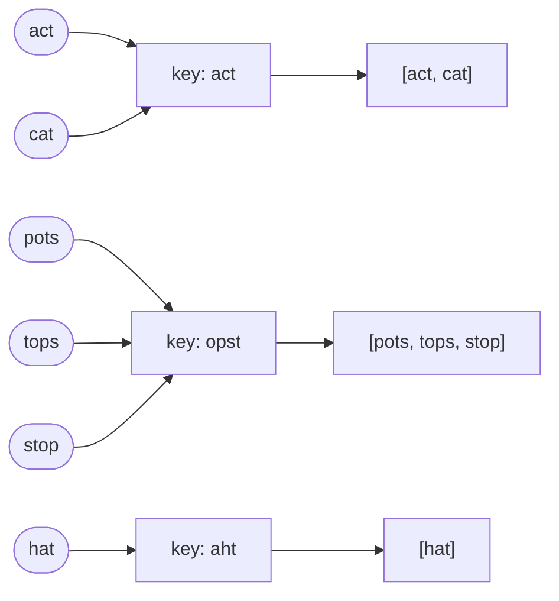

Given an array of strings `strs`, group the anagrams together (same letters, any order). The output order doesn't matter.

## Examples

```
Input:  strs = ["act", "pots", "tops", "cat", "stop", "hat"]
Output: [["hat"], ["act", "cat"], ["stop", "pots", "tops"]]
```

```
Input:  strs = ["x"]
Output: [["x"]]
```

```
Input:  strs = [""]
Output: [[""]]
```

{: .intuition }
> **Anagrams sort to the same string.** Use the sorted word as a hash-map key and push the original word into that key's bucket. Each bucket is one group.

## Dry run



## Code

```cpp
class Solution {
public:
    vector<vector<string>> groupAnagrams(vector<string>& strs) {
        unordered_map<string,vector<string>> mp;
        for (int i = 0 ; i< strs.size();i++){
            string temp = strs[i];
            sort(temp.begin(),temp.end());
            mp[temp].push_back(strs[i]);
        }
        vector<vector<string>> ans;
        for ( auto i :mp  )
        ans.push_back(i.second);

      
        return ans;
        
    }
};
```

## Better: letter-count key, O(n·k)

Sorting each word costs `k log k`. Counting letters costs `k`. Two words are anagrams exactly when their 26 letter counts match, so build the key from the counts instead. A `string(26, 0)` works as the key, and counts up to 100 fit in a `char`.

```cpp
class Solution {
public:
    vector<vector<string>> groupAnagrams(vector<string>& strs) {
        unordered_map<string, vector<string>> mp;
        for (string& s : strs) {
            string key(26, 0);
            for (char c : s) key[c - 'a']++;
            mp[key].push_back(s);
        }
        vector<vector<string>> ans;
        for (auto& [k, group] : mp) ans.push_back(move(group));
        return ans;
    }
};
```

{: .pitfall }
> `for (auto i : mp)` copies every key and every vector, then `push_back(i.second)` copies the vector again. Use `auto&` and `move(group)` so each group is moved once instead of copied twice.

{: .revisit }
> Sort a **copy** (`temp`), never `strs[i]` itself, or you lose the original word you need to output. The empty string is a valid key too: `""` sorts to `""`, so it forms its own group.
