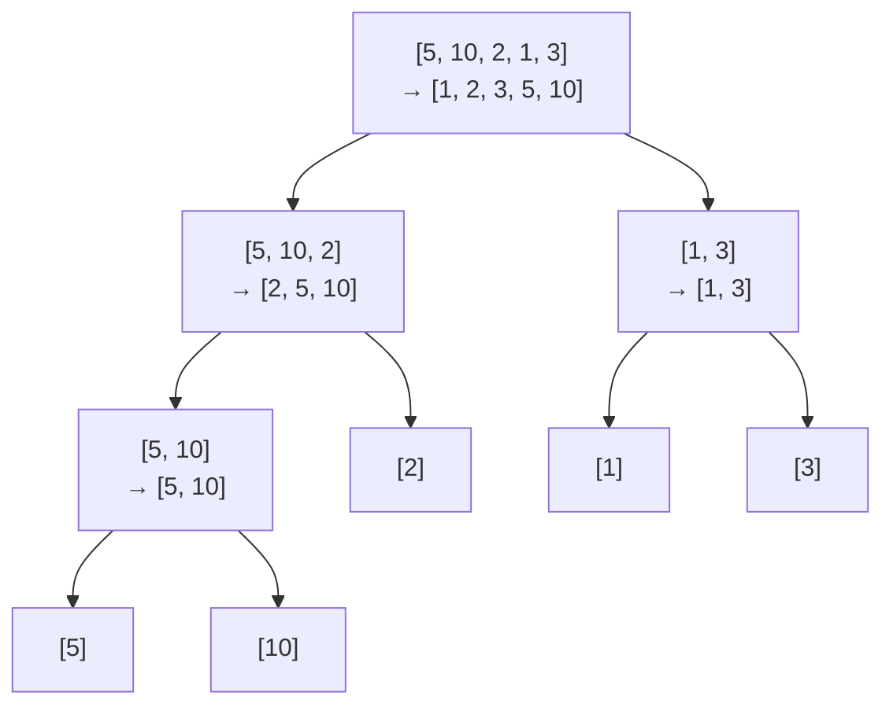

Sort `nums` in ascending order **without built-in sort functions**, in O(n log n) time and with the smallest space possible.

## Examples

```
Input:  nums = [10, 9, 1, 1, 1, 2, 3, 1]
Output: [1, 1, 1, 1, 2, 3, 9, 10]
```

```
Input:  nums = [5, 10, 2, 1, 3]
Output: [1, 2, 3, 5, 10]
```

{: .intuition }
> **Merge sort: split in half, sort each half, merge two sorted halves.** A single element is already sorted. Merging uses two pointers: always take the smaller front element into `temp`, then copy `temp` back into `arr[l..r]`.

## Dry run

Split down, merge up: each node shows its part `→` the merged result.



Array after each `merge` call:

<div class="viz">
<p class="viz-legend"><span class="hl">■ just merged</span> · <span class="done">■ final</span></p>





</div>

## Code

```cpp
class Solution {
public:
    vector<int> sortArray(vector<int>& nums) {
        mergeSort(nums, 0, nums.size() - 1);
        return nums;
    }

private:
    void mergeSort(vector<int>& arr, int l, int r) {
        if (l >= r) return;
        int m = (l + r) / 2;
        mergeSort(arr, l, m);
        mergeSort(arr, m + 1, r);
        merge(arr, l, m, r);
    }

    void merge(vector<int>& arr, int l, int m, int r) {
        vector<int> temp;
        int i = l, j = m + 1;

        while (i <= m && j <= r) {
            if (arr[i] <= arr[j]) {
                temp.push_back(arr[i++]);
            } else {
                temp.push_back(arr[j++]);
            }
        }

        while (i <= m) temp.push_back(arr[i++]);
        while (j <= r) temp.push_back(arr[j++]);

        for (int i = l; i <= r; i++) {
            arr[i] = temp[i - l];
        }
    }
};
```

## Better: heap sort, O(1) extra space

The problem asks for the smallest space possible. Merge sort needs O(n) for `temp`, but heap sort sorts in place:

1. **Build a max-heap** inside the array: sift down every non-leaf, from `n/2 - 1` back to `0`.
2. **Repeatedly move the max to the end.** Swap `nums[0]` with the last slot of the heap, shrink the heap by one, and sift the new root down.

`heapify` is a loop, not recursion, so there's no stack cost either.

<div class="viz">
<p class="viz-legend"><span class="hl">■ moved this step</span> · <span class="done">■ final</span></p>






</div>

```cpp
class Solution {
public:
    vector<int> sortArray(vector<int>& nums) {
        int n = nums.size();
        for (int i = n / 2 - 1; i >= 0; i--) heapify(nums, n, i);  // build max-heap
        for (int end = n - 1; end > 0; end--) {
            swap(nums[0], nums[end]);  // max goes to its final slot
            heapify(nums, end, 0);     // fix the shrunken heap
        }
        return nums;
    }

private:
    void heapify(vector<int>& a, int n, int i) {
        while (true) {
            int big = i, l = 2 * i + 1, r = 2 * i + 2;
            if (l < n && a[l] > a[big]) big = l;
            if (r < n && a[r] > a[big]) big = r;
            if (big == i) return;
            swap(a[i], a[big]);
            i = big;
        }
    }
};
```

{: .pitfall }
> Plain quick sort with the first or last element as pivot gets **TLE** here. LeetCode includes sorted inputs and arrays full of duplicates, which push it to O(n²). Use merge sort or heap sort, or quick sort with a random pivot and three-way partitioning.

{: .revisit }
> Merge sort is **stable** (`<=` takes from the left on ties) and always O(n log n), at the cost of O(n) space. Heap sort is O(1) space but not stable. In merge sort, `vector<int> temp` is reallocated on every call. One buffer of size `n`, allocated once and passed down, avoids that.
